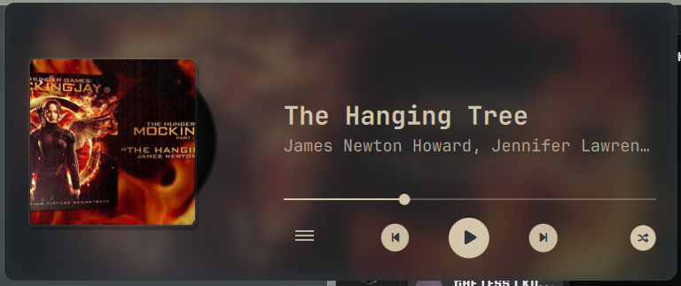
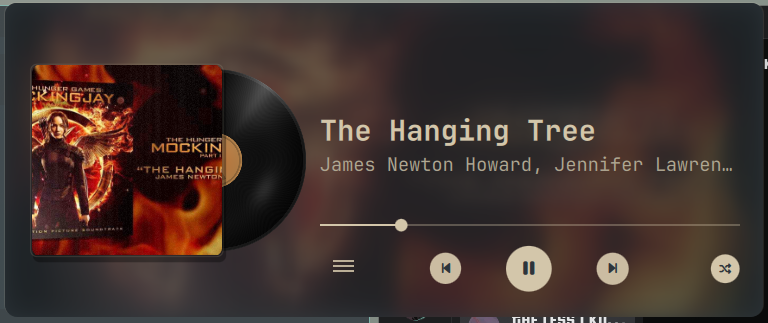

# Omasleeve

Omasleeve is a quiet now-playing surface for the Omarchy bar. It holds one fixed width, reads Omatunes' real
state, and never pretends to be the player. Omatunes keeps the library, the queue, the audio engine
and the truth about what is playing; this plugin is the small place you glance at.

<p align="center">
  
  <br><em>In the bar: a fixed-width pill. Long titles are elided, never allowed to push the bar around.</em>
</p>

<p align="center">
  
  <br><em>Left-click the pill: a compact card, not a second window.</em>
</p>

<details>
<summary>Resting state</summary>

<p align="center">
  
</p>

</details>

## Why it exists

A media widget should answer three questions without becoming a second application: what is playing,
what can I do with it, and where is it. This one is built around that restraint.

- **The bar never moves.** The pill is a standalone capsule with a fixed width. A one-word title and
  a four-line title occupy the same space; the text elides inside its own box.
- **Nothing is guessed.** Shuffle, repeat, the equalizer and the liked flag are Omatunes' own state.
  The card mirrors what the app reports instead of keeping a private copy that can drift.
- **Play means play.** With no player running, the control starts Omatunes as a process with no
  window at all — Wayland offers no honest way to unmap a toplevel — and begins playback. The cover
  is the door to the window when you actually want it.
- **Motion has a job.** The card arrives on the desktop's own switching curve. The record, sleeve
  lift and shadow share one short curve, so nothing trails the thing it belongs to.

## Install

```bash
omarchy plugin add https://github.com/habdelrahman510-tech/omasleeve --enable --yes
```

Or, if it is already installed:

```bash
omarchy plugin update omatunes --yes
```

The plugin installs as `omatunes`, needs Omatunes 2.1 or newer for the full feature set, and lands in
`center` unless your `shell.json` says otherwise. The repository is named Omasleeve; the plugin id
stays `omatunes` so existing installs keep working.

### Keeping a local checkout permanent

`omarchy plugin update` replaces the installed plugin, and `pacman -Syu` can replace the patched
player with an older packaged build. From this checkout, one command restores the whole setup:
plugin sync, panel and transport keybindings, the patched player in `/usr/local/bin`, reload and
verification.

```bash
./scripts/make-permanent.sh
```

It is idempotent and safe to re-run after any update. It asks for privileges through `pkexec` only
when rebuilding the player. Set `OMATUNES_APP_REPO` if the player checkout is not at
`~/Projects/omatunes`.

## What you see

**In the bar** — a 20px cover disc, `Artist — Title` elided inside its own box, a play/pause control
and a two-pixel hairline of elapsed time. The accent ring and hairline appear only while something is
playing; a liked track gets a small heart on the disc instead of a glyph in the row.

**In the card** — the current artwork is the only backdrop, cropped to cover and blurred once. There
are no gradients, no palette extraction and no stacked glass panels. A square sleeve holds the album
cover with softly rounded corners, a contact shadow and a faint printed-paper grain.

A black vinyl record sits behind it, with pressed grooves, a low sheen and a warm label with a
spindle hole. On play it glides out and spins. On pause it coasts down and retreats to a resting
sliver, which is also how it sits when Omatunes is closed. A track change pulls it back to that
sliver first, then brings it out with the new track. The artwork container reserves the record's
travel, so it never reaches the text.

A pointer-following light treats the two surfaces differently: the card gets a neutral lift from a
pre-rendered radial texture clipped to its bounds, while the sleeve brightens with its own pixels as
the pointer approaches. No overlay is painted over the cover.

Title and artist sit beside a seekable timeline that reveals elapsed and total time while you point
at it. Previous, play/pause, next and shuffle sit in the reference positions; the three-bars control
opens a compact panel with Omatunes' real repeat mode and equalizer. The card grows downward to hold
that panel, so it never covers the track it belongs to.

There is no queue column and no context heading. A now-playing card shows what is playing and the
controls for it — nothing else.

## Controls

| Where | Action |
|---|---|
| Pill, left click | Open or close the card |
| Pill, middle click | Like / unlike the current track |
| Pill, cover | Show the Omatunes window, or start one |
| Pill, play/pause | Play or pause; with no player, start Omatunes hidden and play |
| Card, sleeve | Show the Omatunes window, or start one |
| Card, timeline | Click or drag to seek |
| Card, transport | Previous / play-pause / next / shuffle |
| Card, three bars | Repeat mode and equalizer |
| `Escape` / click outside | Close the card |
| `Super + Alt + O` | Open the card from anywhere, with the bar shown or hidden |
| `Alt + XF86PickupPhone` | Play/pause — matches the modifier state at key-down; starts Omatunes hidden if closed |
| `Ctrl + Alt + XF86HangupPhone` | Next track — matches your next button's modifier order |

Volume is deliberately absent. Omatunes owns its own volume; use the application or the desktop
mixer rather than a second control surface that can disagree with it.

## Motion

The card fades and slides in, and dissolves out, on the desktop's own switching transition rather
than a curve of its own: the `smooth` bezier in `~/.config/hypr/looknfeel.lua`
(`cubic-bezier(0.22, 1, 0.1, 1.1)`), overshoot included. The panel contributes its own envelope
(180ms in, 120ms out, 3% scale from the bar edge); the card adds a 24-design-pixel slide and a fade
over 240ms.

Card height follows the same curve, so opening the utility panel stretches it downward instead of
jumping between two sizes.

The record's travel, the sleeve's lift and its contact shadow share one 280ms OutCubic budget, so
none finishes after another and reads as a stutter. Rotation is a declarative animation on the
render loop, not a JavaScript timer pretending to be a frame clock; on pause the platter coasts
through a short tail before settling.

With bar animations disabled, the card simply appears and disappears — no travel, no fade.

## How it talks to Omatunes

| Capability | Interface | Notes |
|---|---|---|
| Track, artist, album, cover, duration | MPRIS `Metadata` | `mpris:artUrl` only, always a local file — the same art the app draws |
| Playback state | MPRIS `PlaybackStatus` | Event-driven; no polling |
| Play/pause/stop, previous, next | MPRIS methods | Guarded by the player's capability flags |
| Shuffle | UDP `shuffle`; state from MPRIS `Shuffle` | Toggle only, app-owned |
| Seek | MPRIS `SetPosition` / `Position`, rebased by `Seeked` | Only when `CanSeek` is true |
| Liked | `xesam:userRating`, else the app's state cache | Read-only |
| Repeat, equalizer, upcoming state | `~/.cache/omatunes_companion.json` | Schema 1, read-only, written by the app |
| Repeat / equalizer changes, like | UDP `127.0.0.1:18888` via `bin/omatunes-ctl` | Argument-validated, one-shot |
| Hidden start / show the window | `omatunes --background`, UDP `show` | One engine; a second launch hands off instead of starting another |
| Theme tokens | `~/.cache/omatunes_theme.json` | Schema 1, read-only, written by the app |

The companion and theme cache files are written atomically by Omatunes and are optional. If they are
absent, the card falls back to the shell theme, hides the equalizer controls and shows no queue.
Nothing in the plugin writes to Omatunes' state or database.

### Artwork

`mpris:artUrl` is the track's own picture, not the album's: Omatunes resolves it the way its player
does — embedded tag picture first, a `cover.jpg`/`folder.jpg` beside the track only when the file has
none — writes the bytes to `~/.cache/omatunes_current_art.jpg`, and appends the track id as a query
(`file://…jpg?t=41`). The query is the image cache key, so a new track cannot show the old sleeve.

The plugin keeps that query but checks only the path: `file://` or an absolute path is accepted,
anything else — `http:`, `data:`, a bare remote reference — is rejected. Metadata can never turn
into a network request.
